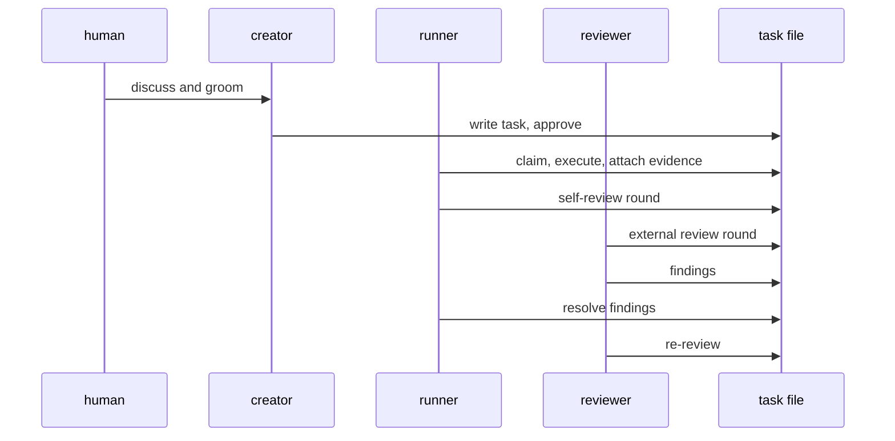

# Roles

The agents that act on tasks. Humans act too, but carry no role.

Task structure, statuses, and transitions live in
[tasks/task-model.md](tasks/task-model.md).

The two interfaces of coding-lanes: **talita**, the CLI tool that writes and
manages tasks (**T**ask **A**ccess and **L**ane **I**nteraction **T**erminal
**A**pp), and **raul**, the TUI that shows them (**R**eview, **A**pprove,
**U**nderstand **L**ane).

## Actors

```json
{ "id": "runner-1", "kind": "agent", "role": "runner", "session": "s-42" }
```

| field | meaning |
|---|---|
| `id` | who acts |
| `kind` | `human` or `agent` — humans carry no role |
| `role` | `creator`, `runner`, `reviewer`, `orchestrator` |
| `session` | the working session, so separation between planning, execution, remediation, and review is structural rather than a matter of discipline |

## The roles



| role | owns | autonomy | never |
|---|---|---|---|
| `creator` | creates and edits tasks: intent, scope, acceptance criteria, steps, questions, meta; approves `groomed → approved` | human-dependent — its content comes from an interactive session with a human | executes or reviews code |
| `runner` | claims approved tasks, writes steps, executes, attaches evidence, applies fixes | autonomous | treats its own self-review as the verdict; approves a task |
| `reviewer` | reviews code, opens findings, gives verdicts | autonomous | writes code |
| `orchestrator` | autopilot flows | autonomous | — |

## Ownership by section

| task section | owner |
|---|---|
| `intent`, `scope`, `acceptance_criteria`, `questions`, `meta` | creator |
| `steps`, `claim`, `status`, evidence | runner |
| `review` | reviewer |
| `notes` | any role |

The reviewer opens findings; the runner resolves them. A role may not write
another role's section.

## Session boundaries

- The session that executes a task never remediates that task's findings.
- The session that planned a task never reviews it.
- A review runs in a session distinct from the runner's, ideally on a
  different model — the diversity is what surfaces uncorrelated bugs.

These are gates, not guidance: a transition that would cross a boundary fails.

## Where roles act

| transition | role |
|---|---|
| — → `draft`, `draft` → `groomed`, `groomed` → `approved`, `needs-human` → `executing`, `done` → `executing` | creator |
| `approved` → `executing`, `executing` → `code-review`, `remediating` → `code-review` | runner |
| `code-review` → `done`, `code-review` → `remediating`, `code-review` → `needs-human` | reviewer |

Full gate conditions are in
[tasks/task-model.md](tasks/task-model.md#transitions).
